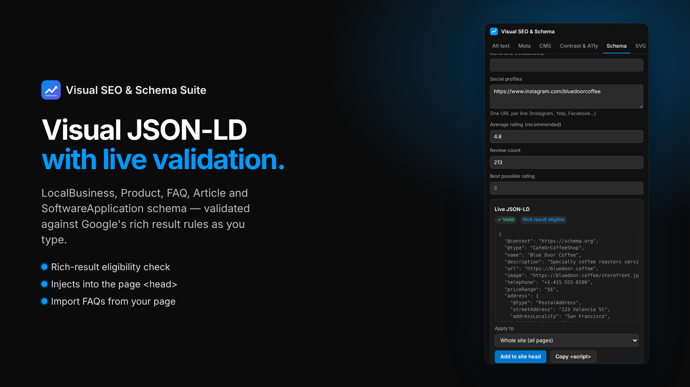

# Visual SEO & Schema Suite

Bulk alt text, meta descriptions, WCAG AA/AAA audits, SVG minification and a visual JSON-LD builder for **Framer** and **Webflow**. Both plugins are built from one shared React + TypeScript core. A small Cloudflare Worker validates Polar.sh license keys and meters 10 free generations per user.



## Monorepo layout

| Package | What it is |
|---|---|
| `packages/core-engine` | Pure TypeScript engine with no DOM and no API keys: alt-text generator and smart filename parser, meta descriptions, WCAG contrast and accessibility auditor, SVG minifier and sanitizer, JSON-LD builder and validator (LocalBusiness, Product, FAQPage, Article, SoftwareApplication), retry/backoff and token-bucket rate limiter, license client, and the `HostAdapter` contract |
| `packages/ui-kit` | Dark-mode React UI (Framer `#111111` and Webflow Designer tokens, plus a light theme), seven tool panels, and an in-memory mock host |
| `packages/framer-plugin` | `framer.json`, Vite + `vite-plugin-framer`, adapter over `framer.getSelection()`, `getManagedCollections()`, `setPluginData()` and `setCustomCode()` |
| `packages/webflow-extension` | `webflow.json` (API v2), Designer API adapter (`getSelectedElement()`, custom attributes, Pages API, JSON-LD custom element), and a throttled Webflow v2 CMS batch updater with exponential backoff on HTTP 429 |
| `packages/license-worker` | Hono Cloudflare Worker: Polar.sh license validation, 10 free credits per user, Webflow Data API CORS proxy |
| `playground` | Browser playground with theme switcher and mock host (`npm run dev`) |
| `e2e` | Headless Chromium tests for both plugins and the playground, including axe WCAG 2.2 AA checks on every tab |
| `scripts/generate-assets.mjs` | Renders marketplace icons, banners and real-UI screenshots into `assets/` |

## Quick start

```bash
npm install
npm run dev                # playground at http://localhost:5173
npm test                   # Vitest across all packages
npm run test:e2e           # builds e2e bundles, runs Playwright (headless Chromium)
npm run typecheck
npm run assets             # regenerate store assets
npm run pack:framer        # Framer plugin.zip
npm run pack:webflow       # Webflow bundle.zip
```

Node 20+ is required.

## How it fits together

```
                ┌──────────────── ui-kit (React panels) ────────────────┐
                │  Alt text · Meta · CMS · Contrast & A11y · Schema · SVG │
                └───────────────▲───────────────────────▲────────────────┘
                                │ HostAdapter            │
             ┌──────────────────┴───────┐     ┌──────────┴──────────────────┐
             │ framer-plugin adapter    │     │ webflow-extension adapter   │
             │ @framer/plugin SDK       │     │ Designer API + Data API v2  │
             └──────────────────────────┘     └──────────────┬──────────────┘
                         core-engine (pure TS)                │ CMS via proxy
                                                     ┌────────▼─────────┐
                     LicenseClient ────────────────▶ │  license-worker  │──▶ Polar.sh
                                                     └──────────────────┘
```

Each feature is written once against `HostAdapter` (`packages/core-engine/src/host.ts`). A host adapter maps those calls onto its SDK, and is unit-tested against an in-memory fake of that SDK. The same fakes are aliased into `--mode e2e` builds so Playwright drives the real plugin UI headlessly.

## Why the CMS updater doesn't crash on 429

`packages/webflow-extension/src/cms/batchUpdater.ts`:

- **Token bucket.** Webflow allows 60 or 120 requests per minute depending on plan; the limiter re-tunes itself live from the `X-RateLimit-*` headers.
- **Global pause on 429.** A 429 pauses all traffic for `Retry-After`, then retries with exponential backoff and jitter.
- **Transient errors.** 5xx and network errors are retried.
- **Validation errors.** On 400/422 the chunk is bisected, so one bad item doesn't fail the other 99.
- **Progress and cancel.** Progress is reported per item, and you can cancel mid-run.

The license worker proxy exposes `Retry-After` and `X-RateLimit-*` to the browser through CORS.

## Shipping

See [SUBMISSION_GUIDE.md](SUBMISSION_GUIDE.md) and [PRIVACY.md](PRIVACY.md).

## License

MIT
